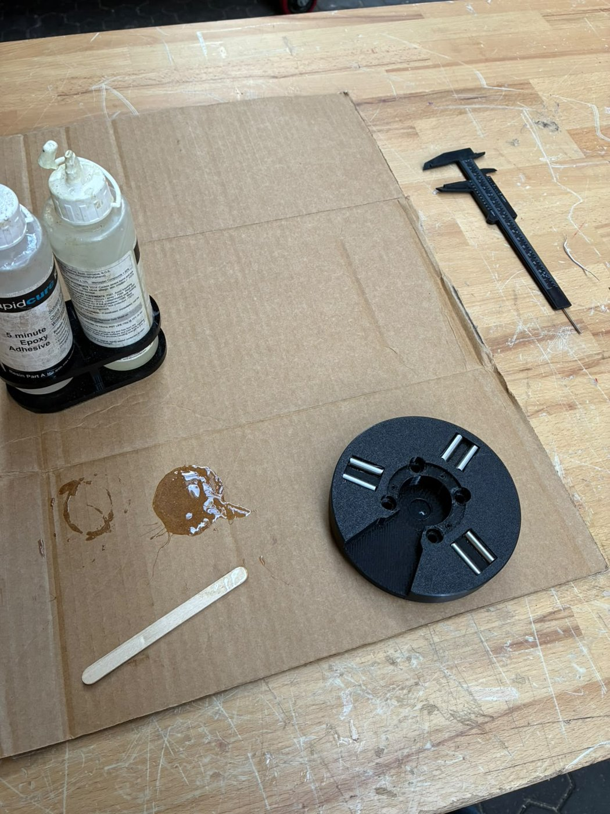
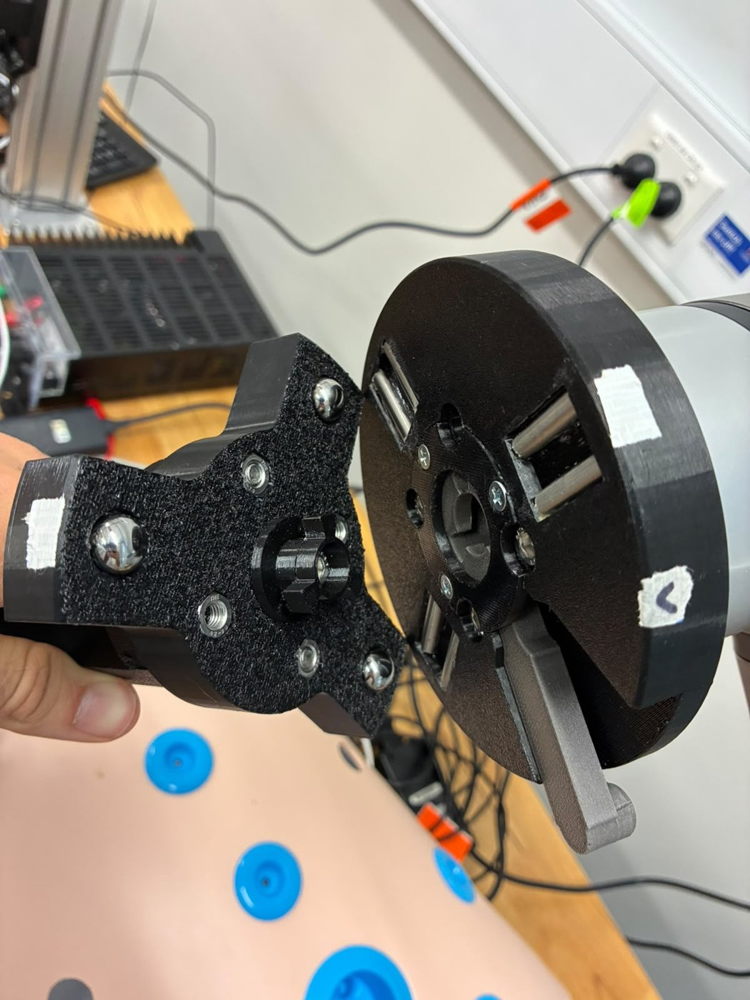
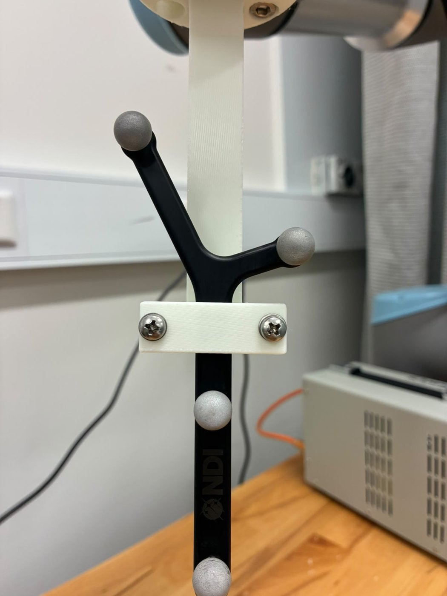
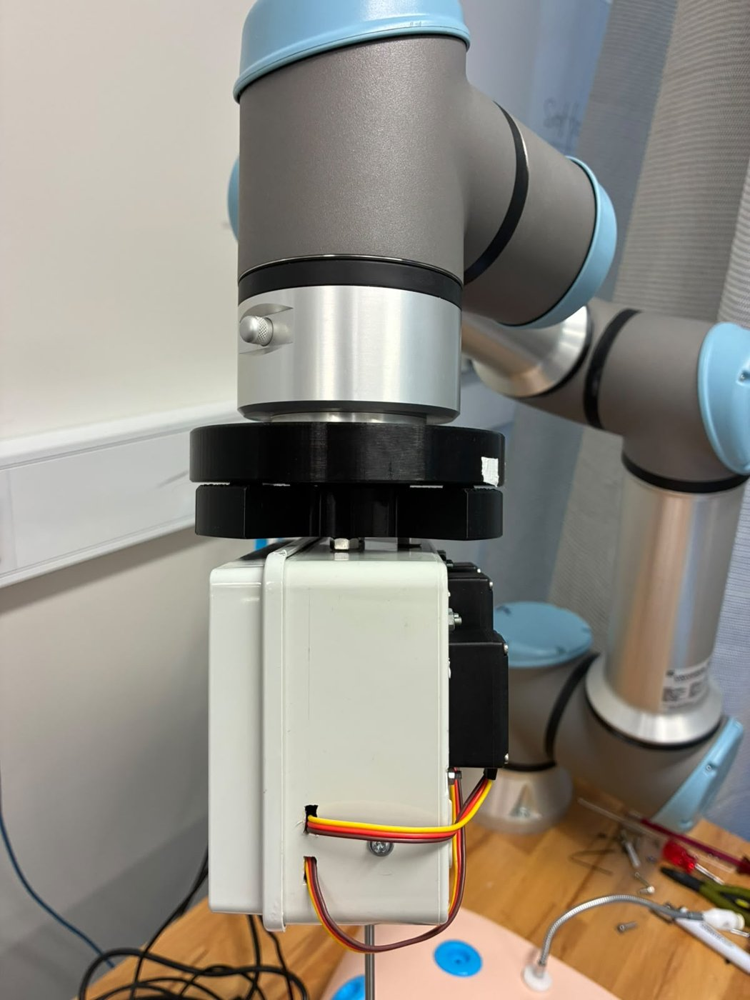
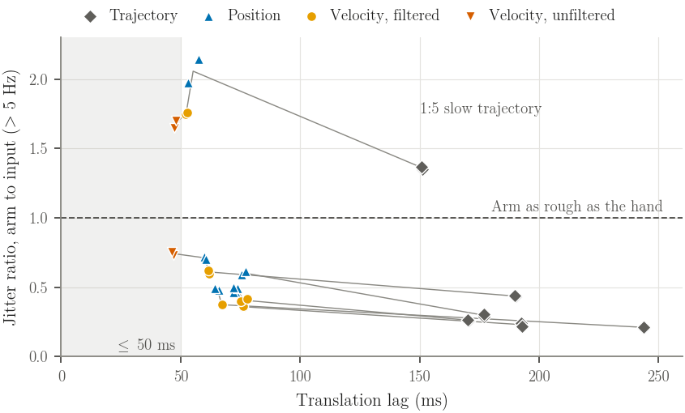

# Thesis Supplementary Material

Supplementary material for the thesis report *Smooth, Safe and Modular: Diagnosing and Removing the Limits of Economical Macro–Micro Surgical
Teleoperation*. It holds the
detail that was moved out of the report's appendices: the stack's version history, software architecture, full
teleoperation settings, hardware design values, calibration procedures, risk assessment and reproducibility notes.

Section, table and equation numbers below refer to the submitted report. Paths are relative to the repository root.

## Contents

1. [Teleoperation stack version history](#1-teleoperation-stack-version-history)
2. [Software architecture](#2-software-architecture)
3. [Teleoperation settings](#3-teleoperation-settings)
4. [Hardware design](#4-hardware-design)
5. [Calibration procedures](#5-calibration-procedures)
6. [Risk assessment](#6-risk-assessment)
7. [Reproducibility and code availability](#7-reproducibility-and-code-availability)
8. [Additional results](#8-additional-results)

---

## 1. Teleoperation stack version history

The table expands Table B.2 of the report (Appendix B.2). Every version is a git tag, or a commit for the changes after V8, and
every run records the code version and all of its settings, so any run can be traced to the code that produced it.
The "reason" column gives the problem as it was diagnosed at the time. Several of those diagnoses were later revised
by the analysis of Chapter 4 ([Section 7.2](#72-development-claims-revised-by-the-analysis)), and the numbers in the
report come from that analysis, not from this history. The full lab log, with the why of every change, is
[`docs/VERSIONS.md`](VERSIONS.md).

| Version | Tag | Change | Reason |
| --- | --- | --- | --- |
| V1 | `v1` | MoveIt Servo joint positions streamed to the forward position controller | Baseline: the first working stylus-to-arm teleoperation |
| V2 | `v2` | MoveIt Servo joint trajectories to the scaled joint trajectory controller | V1 crawled: Servo re-based each step on the lagging measured joints |
| V3 | `v3` | Motion scales 1:1, 1:5 and 1:20, cycled by a double click | Fine positioning |
| V4 | `v4` | Velocity output (`speedj`) as an option; stylus recording and replay; the arm emulator; the lookahead and pose-source studies | The trajectory route's lag floor |
| V5 | `v5` | Constant-velocity Kalman filter on the stylus; command low-pass filter; robot pose from `/joint_states`; 500 Hz command chain; joint limiter after Servo | Velocity output vibrated and faulted the arm: unsmoothed velocity output, amplified tremor, 4 ms device updates and a 20 Hz pose |
| V6 | `v6` | Singularity guard; RCM mode with a latched pivot | The arm stalled in singularities; laparoscopic tools must pivot about a port |
| V7 | `v7` | Depth-invariant RCM law; RCM entry and exit rules; the wand as a calibrated RCM tool; tracker recording of every run; split haptics driver and cues | Large arm motion near the port; independent RCM measurement; no force rendered inside ROS 2 |
| V8 | `v8` | Macro–micro switch on the grey button; numbered tool library; ramped `speedj` script; micro module repaired in software; single-marker tip calibration | One stylus for both stages; tool exchange; buzz under acceleration |
| After V8 | `1b9b502` | Position output (`servoj` with a 30 ms lead), the default; rotation scale exponent 0.5 to 1; recording allowed without the tracker; launcher stops orphaned drivers | `speedj` buzz was pose-dependent; stale `/joint_states` from orphaned drivers entered live sessions |
| V9 | `9d4f2ee` | Calibrated kinematics loaded from the arm; final settings of [Section 3](#3-teleoperation-settings) | The nominal kinematic model |

### 1.1 Recovering the early code states

V1, V2 and most V3 runs were recorded on uncommitted code. Their code was rebuilt by replaying every file edit from
the development sessions, in order, on top of the last commit, together with the editor's saved copies of the
settings file. Two checks confirmed the reconstruction: replaying the edits up to the next commit reproduced that
commit byte for byte (all 39 tracked files), and every V1–V3 run's recorded settings matched the rebuilt settings
file at the time of that run. The tags `v1`, `v1-90deg` and `v2` are these rebuilt states; `v3` onwards are
ordinary commits.

### 1.2 Command filter cut-off

The command filter was introduced at 8 Hz in V5. On the arm it removed most of the 15–25 Hz vibration, but motion
at 8–10 Hz remained, which was hand tremor that an 8 Hz filter only halves at 10 Hz. The cut-off was lowered to
6 Hz, which cut the tool's angular jerk by about a third for a few milliseconds more lag, and then to 5 Hz after the
benchmark comparison, which cut the 5–15 Hz position jitter by a further 13 % for 4–8 ms more lag. These are
development measurements on hand-made and replayed runs, and the lag cost inside the loop was later re-measured with
the loop model (report Section 4.1.3).

### 1.3 Sideways scaling in RCM mode

The depth laws tried before the depth-invariant law of report Section 3.3.3. Each assigns the tip a share of the
sideways stylus motion as a function of insertion depth $d$; $k$ is the sideways gain and $r(d)$ the distance from
`tool0` to the RCM point.

| Law | Tip share of sideways motion | Why it was rejected |
| --- | --- | --- |
| V6 fade | $(d/10\,\mathrm{mm})^2$ below 10 mm, then 1 | Large accelerations near the point on the arm; a kink at 10 mm |
| Smootherstep fade | $10t^3 - 15t^4 + 6t^5$, $t = d/30$ mm | Still large arm motion near the point on the arm |
| Stronger fade | The smootherstep cubed | Beyond 30 mm the fixed tip scale returned: the arm moved 9 times the tip at 30 mm, so the feel changed with depth |
| Fade with constant flange gain | Cubed fade $\times\, k\,d/r(d)$ | Rough around 30 mm on the arm, and moving in and out swung the flange sideways |
| Depth-invariant (final) | $k\,d/r(d)$, no fade | Jumps at zero depth, from a separate code branch, fixed so the law is continuous through zero |

All the fades failed in the same way. The stylus target is absolute, so the sideways motion a fade holds back at
shallow depth returns as the tool goes deeper, and moving in and out across the fade swings the flange sideways even
when the hand does not move sideways. The final law has no fade. The development runs used $k = 0.5$; every
recorded RCM run in Chapter 4 used $k = 1.0$.

---

## 2. Software architecture

The stack is one ROS 2 package, `macro_micro_robot`, used with the Universal Robots driver, MoveIt Servo, the
3D Systems Touch driver and a stand-alone tracker program (the separate `ndi_tracking` package). A launcher script
([`scripts/launch_system.sh`](../scripts/launch_system.sh)) starts the session in one command, gives each process its
own process group so that shutdown stops all of it, and refuses to start while a driver from an earlier session is
still running on the same ROS 2 domain. Launch files: [`launch/ur16e_teleop.launch.py`](../launch/ur16e_teleop.launch.py)
and [`launch/touch_driver.launch.py`](../launch/touch_driver.launch.py). The block diagram source is
[`docs/system_architecture.drawio`](system_architecture.drawio).

### 2.1 Processes of a teleoperation session

"This work" marks the processes shown in orange in the report's signal-chain figure (Fig. 3.4).

| Process | Source | Role |
| --- | --- | --- |
| `ur_robot_driver` (`ros2_control` node, External Control script) | UR driver | Joint state at 500 Hz with motor currents; trajectory, velocity and position controllers; speed-scaling and TCP broadcasters. With the ramped `speedj` option, a modified URScript program |
| `servo_node` | MoveIt Servo 2.12.4 | Inverse kinematics of the twist each cycle; joint-limit, collision and singularity checks; output type set per mode at launch |
| [`joint_velocity_limiter`](../src/joint_velocity_limiter.py) | This work | Joint speed and acceleration caps after Servo; in position output, the integral and 30 ms lead; 50 ms watchdog |
| [`ur16e_touch_teleop`](../src/ur16e_touch_teleop.py) | This work | Clutch, mapping and scale; Kalman filter; control law and command filter; RCM; singularity guard; tool library; macro–micro switch; haptic cue forces |
| [`touch_server`](../src/touch_server.cpp) | This work | OpenHaptics device loop only (no ROS 2 libraries); renders forces and walls at the device rate |
| [`touch_bridge`](../src/touch_bridge.cpp) | This work | ROS 2 side of the Touch: publishes pose, buttons and encoder angles, forwards forces; UDP to `touch_server` |
| [`stylus_replay`](../src/stylus_replay.py) | This work | Plays a recorded stylus file in place of the device, with the original timing |
| [`trajectory_recorder`](../src/trajectory_recorder.py) | This work | Run folder: CSV files, bag, settings and code version (report Section 3.4.1) |
| `ndi_tracking` | This work (no ROS 2) | Vega over its TCP interface at 60 Hz; writes tool tip and axis into the same run folder on the same clock |
| [`micro_module_control`](../src/micro_module_control.cpp), serial bridge | Scott (2023), repaired | Stylus to motor angles; serial link to the Arduino |
| [`ur_emulator`](../src/ur_emulator.py) | This work | Simulation only: the arm's measured response on mock hardware (report Section 3.4.2) |
| [`trajectory_player`](../src/trajectory_player.py) | This work | Scripted joint motions (calibration jogs, the camera test) through the trajectory controller |

### 2.2 Command path by output mode (after MoveIt Servo)

| Mode | Servo output | Then | UR command |
| --- | --- | --- | --- |
| Trajectory | `JointTrajectory` to `/scaled_joint_trajectory_controller/joint_trajectory` | Trajectory controller interpolates | `servoj` |
| Velocity | Joint velocities to `/joint_velocity_limiter/commands` | Limiter to `/forward_velocity_controller/commands` | `speedj` |
| Position | Joint velocities to `/joint_velocity_limiter/commands` | Limiter integrates, adds the lead, to `/forward_position_controller/commands` | `servoj` |

The Touch driver replaces the community `omni_state` node with the same topic names (`/phantom/state`,
`/phantom/button`, `/phantom/joint_states` and `/phantom/force_feedback`), so the rest of the stack is unchanged.
The split into two processes is what lets OpenHaptics render force (report Appendix A.2, haptics bench tests; handoff
notes in [`docs/HAPTICS_HANDOFF.md`](HAPTICS_HANDOFF.md)).

The teleoperation node runs from a live Touch or from a replay, selected by a launch argument; the replay feeds the
same node, so replayed and live runs differ only in where the stylus pose comes from. Mock hardware, with or without
the emulator, is selected the same way, and new code ran on a private ROS 2 domain so that it could not reach the
arm (report Section 3.4.4). Run instructions: [`docs/RUN_UR16E_TOUCH.md`](RUN_UR16E_TOUCH.md).

---

## 3. Teleoperation settings

Every setting lives in [`macro_micro_robot/teleop_settings.py`](../macro_micro_robot/teleop_settings.py) and is
recorded with each run (`META.yaml` in the run folder). The control-law and Kalman parameters are in the report
(Table A.1). The values below are the defaults at the final commit (`9d4f2ee`), checked against the settings
recorded with the final benchmark. In that benchmark the modes differed only as in
[Section 3.2](#32-settings-that-differed-between-output-modes-in-the-final-benchmark), and every recorded comparison
used a rotation scale exponent of 0.5 rather than the default of 1 (report Section 3.3.1).

### 3.1 Other teleoperation settings in the final stack

| Setting | Value | Role |
| --- | --- | --- |
| ***Mapping and input*** | | |
| Motion scales | 1:1, 1:5, 1:20 | Cycled by a double click (within 0.3 s) |
| Rotation scale exponent | 1 (0.5 in all recorded comparisons) | Rotation scaled by $s^{e}$ |
| Deadband | 300 µm at 1:1 | Shrinks with the scale |
| Stylus timeout | 0.1 s | Arm stops if no stylus data arrives |
| Mode-switch hold | 1.0 s | Grey button: arm or micro module |
| ***Joint limiter and position output*** | | |
| Joint speed cap | 80 % of each joint's limit | 1.68 rad/s base and shoulder; 2.51 rad/s elbow and wrists |
| Joint acceleration cap | 8, 8, 15, 25, 25, 25 rad/s² | Base to wrist 3 |
| Corner smoothing | Two first-order stages, 3 ms | After the caps |
| Watchdog | 50 ms | Zero command if Servo falls silent |
| Position lead | 30 ms | Report Eq. 3.5 |
| Maximum integral lead | 0.15 rad | Over the measured joints |
| ***MoveIt Servo and the singularity guard*** | | |
| Servo rate | 500 Hz | Velocity and position output |
| Trajectory lookahead | 0.05 s | Trajectory output only |
| Servo singularity thresholds | 100 / 200 | Raised out of the way while the guard runs |
| Guard thresholds | $c$ = 30 (start) / 60 (stop) | Report Section 3.3.4 |
| Guard damping | up to 0.05 | Damped least squares |
| Guard escape speed | 0.2 rad/s | Above $c = 60$ |
| ***RCM*** | | |
| Sideways gain $k$ | 1.0 | Up to 130 mm depth |
| Drift correction $K_c$ | 8 s⁻¹ | Report Eq. 3.6 |
| Hold threshold | 5 mm | Arm holds if the shaft is further off the point |
| Exit depth / retract | 3 mm / 5 mm | Report Section 3.3.3 |
| ***Tool library*** | | |
| Switch interlock | joints < 0.01 rad/s for 0.5 s | Not in RCM mode, not while driving |
| ***Haptic cues (not evaluated, report Section 4.2.2)*** | | |
| Force cap | 0.01 N | Faulty unit: same kick at any larger command |
| Slew limit | 2 N/s | Rounds every step in force |
| Cue forces | 0.002 N (crossing, limit), 0.005 N (singularity) | Just above the felt threshold |

### 3.2 Settings that differed between output modes in the final benchmark

From each run's record.

| Setting | Trajectory | Position | Velocity, filtered | Velocity, unfiltered |
| --- | --- | --- | --- | --- |
| Servo output | trajectory | position | velocity | velocity |
| Command filter | 5 Hz | 5 Hz | 5 Hz | off |
| Kalman filter | on | on | on | off |
| Ramped `speedj` script | – | – | on | off |

---

## 4. Hardware design

### 4.1 Quick-change coupling

The coupling was modelled parametrically in Onshape FeatureScript, so that each version is a change of parameters
rather than a new model (C1 printed; C2 and C3 with steel rods and balls). The section view is Fig. 3.3a of the
report.

**Design values (C2 and C3 unless stated)**

| Feature | Value |
| --- | --- |
| Mounting faces | ISO 9409-1-50-4-M6 on both plates: four M6 on a 50 mm pitch circle, Ø31.6 mm recess, Ø6 mm dowel. The tool face sits 39.5 mm from the flange along its axis |
| Seats | Three V-grooves at 0°, 105° and 255° on an 88 mm pitch circle, each a pair of parallel 6 mm steel rods bonded into the robot plate, contacts at 45° (C1: printed 90° grooves) |
| Balls | Three 12.7 mm grade G20 hardened steel balls, bonded with epoxy in 0.4 mm clearance pockets cast against the rods; pitch circle 88 mm (C2), 99 mm (C3); C1: printed domes |
| Preload mechanism | Face-cam ring with an integral lever, 32° swing; its lip draws the lugs of a T-bar (two lugs in C1, three at 90°, 210° and 330° in C2 and C3, 12° dwell) |
| Preload path | T-bar slides on an ISO 7379 Ø8 × 16 mm M6 shoulder screw fixed in the tool plate and compresses a spring (outer diameter 12 mm, wire 1.6 mm, free length 20 mm, 14 N/mm) |
| Design preload | About 107 N; tipping moment about 1.2 N·m (not measured) |
| Parts | Robot plate, cam lever ring and cam retainer on the arm side; tool plate and T-bar on the tool side; all printed in PETG (C2: 100 % infill in load-bearing parts, 50 % elsewhere; C3: 40 % default) |
| Tool plate, C3 | Lightened to a 70 mm core with a 32 mm arm to each ball and scalloped gaps |

**Weighed masses**

| Part | Mass (g) |
| --- | --- |
| Robot plate with rods, cam ring and lever (two prints) | 169, 189 |
| Tool plate with balls, C2 | 193 |
| Tool plate with balls, C3 | 124 |
| Wand holder (tool side) | 68 |
| Tool plate with wand holder fitted | 207 |
| Flange bolts | 14 |

**Build photos**

| (a) Rods bonded into the robot plate with epoxy | (b) C3 tool plate approaching the robot plate |
| --- | --- |
|  |  |
| **(c) NDI wand clamped in its printed holder** | **(d) Micro module mounted through the coupling** |
|  |  |

### 4.2 Wand holder

The wand holder clamps the NDI passive four-marker wand coaxially with the coupling axis, in a V-groove closed by a
flat cap on two M4 screws. It was built to tolerate the wand's unmeasured dimensions. The wand tip sat 367 mm from
the flange in the first holder and 325 mm in the second, whose body was 45 mm shorter (report Section 3.2.1).

### 4.3 Micro module

The micro module's hardware, wiring and parts list are those of Scott (2023): four hobby servos pulling the tendons
of a continuum tip on a 4 mm stainless steel tube, driven by an Arduino Mega 2560 in a junction box, at a parts cost
of about AUD 250 ([`PartsList.pdf`](PartsList.pdf)). The repairs made in this work are listed in report Section
3.2.2, and its software faults in Section 4.4.2. It was mounted on a coupling tool plate (photo (d) above).

---

## 5. Calibration procedures

The steps behind the calibrations of report Section 3.4.3. Each procedure is a script in the repository that writes a
self-describing calibration file to [`config/calibrations/`](../config/calibrations), and each tool in the library
([`config/tools.yaml`](../config/tools.yaml)) points to the file it came from.

### 5.1 Arm kinematics

Code: [`src/ur_calibration_extract.cpp`](../src/ur_calibration_extract.cpp),
[`launch/ur_calibration_extract.launch.py`](../launch/ur_calibration_extract.launch.py); notes in
[`docs/UR_CALIBRATION_FIX.md`](UR_CALIBRATION_FIX.md).

Universal Robots measures each arm in the factory and stores corrections to its Denavit–Hartenberg parameters on the
controller. The ROS 2 driver uses the nominal model unless a calibration file is supplied, and warned of the mismatch
on every connection in this work up to V8. Its extraction tool failed in two ways. First, with the installed client
library it never opened its connection to the controller and waited indefinitely. Second, once connected, it wrote
each link's rotation as intrinsic X–Y–Z Euler angles where the robot description expects fixed-axis angles. The two
agree only when at most one angle is non-zero, so most links came out slightly rotated, by up to 3.2 mm at the flange
on a synthetic UR16e calibration, and the driver's own check cannot see this because it compares a hash copied from
the controller.

The extractor written here connects with a bounded number of retries, converts the parameters with the corrected
upstream code, and before writing rebuilds the arm twice over 10 000 random joint configurations: once from the
file, as the robot description does, and once from the controller's raw parameters. It refuses to write the file if
any transform element differs by more than $10^{-9}$, and it records in the file the raw parameters, the check
result and how far the nominal model is from this arm. After loading, the driver reported that the calibration
matched, and the flange computed in ROS 2 agreed with the controller's to the figures given in report Section 3.4.3.
The tool calibrations below were redone with the calibrated model, because calibrations fitted through the nominal
model partly absorb its error.

### 5.2 Wand pivot calibration

Code: the `ndi_tracking` package (separate ROS 2 workspace package).

The tracker reports the pose of the wand's first marker, not its tip, so the tip was located once off the arm. With
the tip in a divot, the wand was swivelled about 30° in every direction for 20 s and the fixed point fitted; a second
recording, twisting the handle about the shaft by ±60°, gave the shaft axis. The pivot residual (report Table 3.1) is
mostly the camera's depth error magnified by the 160 mm lever from markers to tip, and it varies with position in the
volume, so three to five attempts with the divot moved around the working area were fitted together, each with its
own pivot point.

### 5.3 Wrist-jog hand–eye calibration

Code: [`scripts/calibration/wrist_jog.py`](../scripts/calibration/wrist_jog.py), [`scripts/calibration/wand_tool_calibration.py`](../scripts/calibration/wand_tool_calibration.py).

1. With the wand in its holder and in view, a script writes a joint motion from the arm's current pose: each of
   wrists 1, 2 and 3 in turn follows $A\sin(2\pi t/T)$ with $A = 30°$ and $T = 14$ s (peak 13°/s), with a pause
   between wrists, and the whole sequence is repeated, about 90 s in all. The trajectory player asks for
   confirmation and runs it through the trajectory controller, so the pendant's speed slider still applies.
2. The tracker records the wand and the controller's flange pose on one clock.
3. The hand–eye transform $X$ is fitted (report Eq. 3.9) over a sweep of the tracker's time offset. Tracker frames
   whose implied camera pose lies more than a set distance from the median, from a blocked marker or a stray
   reflection, are removed and the fit repeated.
4. Each half of the recording is fitted on its own. Each half contains all three wrist rotations, which is why the
   sequence runs twice, and the two tips must agree within 2 mm.
5. The acceptance checks of report Section 3.4.3 are applied, and the script writes the calibration file and prints
   the command that adds it to the tool library. The library itself is changed only by hand.

### 5.4 Micro module tip

Code: [`scripts/calibration/micro_tool_calibration.py`](../scripts/calibration/micro_tool_calibration.py).

The micro module carries no rigid marker body. Four single markers were fixed to it: two on opposite sides at the
base of the metal shaft and two on opposite sides at its end, with the gaps of each pair checked with callipers. The
arm was moved by hand in freedrive for 120 s, turning the tool about its shaft so that each marker faced the camera
for a good part of the time and tilting it by more than 30° each way. Opposite markers are never seen together and
need not be: each is fitted as a point fixed in `{tool0}` over the whole recording, together with the base-to-camera
transform. The midpoint of each pair lies on the shaft axis, so the markers' own offsets cancel. The tip was placed
21.8 mm beyond the end of the metal shaft along that axis, measured by hand, with the continuum section assumed
straight at rest. The raw recording is kept ([`config/calibrations/raw/`](../config/calibrations/raw)), so the tip
can be refitted if the extension is re-measured. An earlier single-marker method, used in V8, was replaced by this
one.

### 5.5 Calibrated tools in the tool library

In `{tool0}`, mm.

| Tool | Tip (x, y, z) | Shaft (mm) | Calibration |
| --- | --- | --- | --- |
| 1, wand in first holder | (−0.41, 9.84, 366.87) | 158.6 | Hand–eye with wrist motions jogged on the pendant, nominal kinematics |
| 2, micro module | (−6.41, 15.56, 436.28) | 267.3 | Four markers, calibrated kinematics |
| 3, wand in second holder | (−1.01, 16.34, 324.99) | 158.6 | Wrist-jog hand–eye, calibrated kinematics |

---

## 6. Risk assessment

The same table is Table B.3 of the report. The arm's general hazards were covered by the robotics laboratory's
induction and risk assessment, and its safety configuration, including the safety planes, was set by the laboratory and not changed (report Section 3.4.4). The
table lists the hazards specific to this work, what could cause them, and the controls used against each. Software
controls act before the arm's own protective stops, which remain the last line of defence, with the emergency stop
within the operator's reach.

| Hazard | Cause | Controls |
| --- | --- | --- |
| Unexpected arm motion from new code | Logic or timing errors in a new version | Mock hardware or the emulator on a private ROS 2 domain first; then the real arm at 1:20 scale with low speed caps; emergency stop within reach |
| Arm keeps moving after the operator lets go | Clutch released, stylus or Servo stops sending | Clutch is a dead-man button: release sends an unfiltered zero; arm stops if no stylus data for 0.1 s; limiter sends zero if Servo is silent for 50 ms; position output holds the last position |
| Excessive joint speed or acceleration | Tool-speed caps do not bound the joints near singularities; rough commands | Joint limiter at 80 % of each joint's speed limit and per-joint acceleration caps, scaling all joints together; Cartesian speed and correction caps |
| Arm stuck or running away near a singularity | Servo halts all motion; a guard that fights Servo's loop | Directional guard on the twist with damped least squares; escape speed limited to 0.2 rad/s; first tested on the mock (report Section 4.2.1) |
| Shaft swept sideways while inserted | RCM lost or left while the tool is deep | Arm holds if the shaft is more than 5 mm off the point; RCM mode can be left only within 3 mm of the point; tool switching refused in RCM mode |
| Wrong tool geometry in use | Tool changed while moving, or unknown tool | Tool switch only with every joint below 0.01 rad/s for 0.5 s; unknown tools refused |
| Replay drives the arm somewhere unsafe | Start pose or path recorded with a different tool or setup | Replay asks for confirmation before moving to the start pose; inputs recorded with a shorter tool not replayed with the wand |
| Vibration and joint faults | Velocity output with rough commands; pose-dependent buzz | Filtering and limiter (V5); a recording that buzzed in velocity output never replayed in velocity output |
| Stale joint states in a live session | Drivers from earlier sessions still running | Launcher stops orphaned drivers at start-up and refuses to run alongside a live driver |
| Controller stalls and program drops | ROS 2 command-line tools during live motion | No command-line tools during motion; logs read afterwards |
| Stylus kick to the operator's hand | Faulty force output; abrupt force steps | Force capped at 0.01 N and slewed at 2 N/s; haptic cues small |
| Pinching at the coupling | Hand at the plates during exchange | Exchanges made only with the arm stationary |

---

## 7. Reproducibility and code availability

### 7.1 Code, data and analysis

All code is in this git repository, forked from the laboratory's macro–micro robot repository, apart from the
`ndi_tracking` tracker package, which sits beside it in the ROS 2 workspace. Each version of the
stack is a tag or commit ([Section 1](#1-teleoperation-stack-version-history)), and every run folder records the
commit it ran and every setting, so a run can be reproduced by checking out its commit and replaying its stylus file
(report Section 3.4.1).

The recordings the results use (373 runs, about 17 GB) are in [`data/recordings/`](../data/README.md) and are never
modified by the analysis. The small per-run files that say what each run was (code version, settings, tool, replay
source) are in git; the per-sample CSVs and rosbags are distributed as a separate archive, checked against
`data/MANIFEST.sha256`. [`data/RECORDINGS.md`](../data/RECORDINGS.md) lists every recording and which results read it.

Each result comes from one folder of [`thesis/results`](../thesis/results/README.md), grouped by report chapter and
numbered in report order (table below). Every folder's script reads the raw files, applies the exclusion checks of
report Section 3.5.7 and writes a results file (`RESULTS.md`) that lists every number it produces, so no number in
the report is typed by hand. The only constants in the code are method choices (bands, windows, the gap and
camera-step limits), stated in each results file. A self-test of the shared code, run before any analysis, checks
the time base of the bag files against the CSV files, the joint ordering, the forward kinematics against the
recorded flange path, and both lag estimators on synthetic delays. `thesis/results/run_all.py` reruns everything.

| Folder | Question | Report section |
| --- | --- | --- |
| M01 | Replay repeatability (noise floors) | 3.4.1 |
| M02 | What each recorded input asks of the arm | 3.4.4 |
| L01 | Lag by version on the same input | 4.1, 4.1.1 |
| L02 | Early versions; emulator lookahead and pose source | 4.1.1 |
| L03 | Displacement delivery ratio by route | 4.1.1 |
| L04 | Velocity-output faults and current chatter | 4.1.2 |
| L05 | Stylus updates, tremor and filters, offline | 4.1.2, 4.1.3 |
| L06 | Closed-loop latency model; filter cost; design map | 4.1.3 |
| L07 | Vibration reduction against the unfiltered baseline | 4.1.3, 4.1.4 |
| L08 | Same-day output-mode benchmark | 4.1.4 |
| L09 | Session D output-mode × filter grid | 4.1.4 |
| L10 | Stylus encoder stalls | 4.1.4 |
| L11 | High-frequency buzz by mode and pose | 4.1.4 |
| S01 | Joint-speed amplification near the singularity | 4.2.1 |
| S02 | Singularity guard on and off | 4.2.1 |
| R01 | RCM scaling laws, offline | 4.3.1 |
| R02 | Tracked RCM error | 4.3.2 |
| R03 | RCM error budget and variance decomposition | 4.3.3 |
| R04 | Camera placement test | 4.3.3 |
| R05 | Cause of the latch offset and its correction | 4.3.4 |
| T01 | Exchange time and re-seat repeatability | 4.4.1 |
| T02 | Macro–micro demonstration; micro-tool fit | 4.4.2 |

### 7.2 Development claims revised by the analysis

The development notes ([`docs/VERSIONS.md`](VERSIONS.md)) recorded a diagnosis and a number for each change. The
analysis treated these as claims to test rather than inputs, and recomputed each from the raw data. The table lists
those it changed.

| Development claim | Analysis | Report section |
| --- | --- | --- |
| Trajectory output delivers 60 % of the commanded displacement | 57 % on the arm, 56 % in the emulator | 4.1.1 |
| V1 lagged 640–760 ms | 377–505 ms on single moves by velocity cross-correlation; the position-shift estimator has no clear minimum there | 4.1.1 |
| The filter adds its open-loop delay (45 ms at 5 Hz) to the lag | 16.5–24 ms in the loop model with only the filter changed; 5.4–16.6 ms measured on the arm | 4.1.3, 4.1.4 |
| Joint-velocity 15–25 Hz power down 76–88 % | 97–99 % in joint velocity, 67–81 % at the flange | 4.1.4 |
| Position output (`servoj`) never buzzes | On the same input, 0.56 A of 80–249 Hz current against 0.11 A in trajectory output | 4.1.4 |
| Slow-speed catches come only from the pitch encoder | Encoder stalls on every joint of the device, most often pitch | 4.1.4 |
| Fixed tip scale needs 30 and 9 times the tip motion at 10 and 30 mm | 36 and 11 times for the tool used | 4.3.1 |
| RCM runs used sideways gain 0.5 | Every recorded run used 1.0 | 4.3.1 |
| The tracked RCM error is factory-kinematics error | Largest term is a latch offset, caused by the tool's line from the hand–eye fit (tilted up to 1.1° from the shaft); kinematic share not separable | 4.3.3, 4.3.4 |
| Median exchange 4.8 s | 5.5–5.6 s per version, timed from the seat being disturbed to settled | 4.4.1 |

## 8. Additional results

### 8.1 Lag against smoothness in the output-mode benchmark

Every replay of the same-day output-mode benchmark (report Section 4.1.4, Table 4.1), plotted as translation lag
against the arm's jitter ratio (arm jitter above 5 Hz divided by the stylus input's). Lines join the output modes on
the same trajectory. Trajectory output is the smoothest but lags 151–244 ms; position and filtered velocity output
sit at 52–78 ms with higher jitter; the slow 1:5 trajectory is the only one where the arm is rougher than the hand.
Moved here from the report's appendix because the report states these values in the text.

Source: [`thesis/results/4.1_latency/L08_output_mode_benchmark`](../thesis/results/4.1_latency/L08_output_mode_benchmark).
